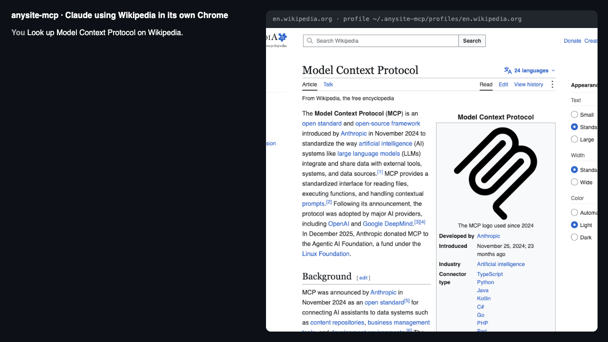

<div align="center">

# anysite-mcp

### Your agent learns a website once, then keeps it as a tool.

**A real Chrome, signed in as you, on your own computer.**

[](https://www.npmjs.com/package/anysite-mcp)
[](https://github.com/DwytMCL/anysite-mcp/actions/workflows/ci.yml)
[](https://modelcontextprotocol.io)
[](LICENSE)

[](https://cursor.com/en/install-mcp?name=anysite&config=eyJjb21tYW5kIjoibnB4IiwiYXJncyI6WyIteSIsImFueXNpdGUtbWNwIl19)
[](https://insiders.vscode.dev/redirect/mcp/install?name=anysite&config=%7B%22command%22%3A%22npx%22%2C%22args%22%3A%5B%22-y%22%2C%22anysite-mcp%22%5D%7D)
[](https://dwytmcl.github.io/anysite-mcp/)

<br>



<br>

```bash
claude mcp add anysite -- npx -y anysite-mcp
```

**No API keys. No cloud browser. No extra LLM. Your logins never leave your machine.**

[Quick start](#quick-start) &nbsp;&middot;&nbsp;
[Why it's different](#why-another-browser-mcp) &nbsp;&middot;&nbsp;
[Tools](#tools) &nbsp;&middot;&nbsp;
[Shortcuts](#shortcuts) &nbsp;&middot;&nbsp;
[Shortcut Library](#the-shortcut-library) &nbsp;&middot;&nbsp;
[Packs](#write-a-pack) &nbsp;&middot;&nbsp;
[Safety](#permissions-and-safety) &nbsp;&middot;&nbsp;
[FAQ](#faq)

</div>

---

## What it is

anysite-mcp is an [MCP](https://modelcontextprotocol.io) server that drives a real Chrome on your computer. Every
site gets its own browser profile that you sign in to once, by hand. The agent then works the site the way a
screen reader does, by role and name, so small redesigns don't break it.

When the agent gets a job done, it can save the steps as a **shortcut**, and that shortcut becomes a new tool it
can call in one step next time.

<table>
<tr>
<td width="50%" valign="top">

**Your accounts, kept apart**<br>
One Chrome profile per site, signed in by hand once. Google sign-in works.

</td>
<td width="50%" valign="top">

**Gets faster with use**<br>
A job the agent has figured out becomes a one-call tool that's there next session. Shortcuts are tested before
they're saved and fail loudly if a page stops looking right.

</td>
</tr>
<tr>
<td valign="top">

**Repairs itself**<br>
When a site renames a button or swaps it for a link, the shortcut finds the new one and updates itself. No extra
LLM needed.

</td>
<td valign="top">

**Learns by watching**<br>
Run `anysite-mcp record github.com my_job`, do the job by hand, and it's a tool.

</td>
</tr>
<tr>
<td valign="top">

**You set the limits**<br>
Per site: read-only, ask before sending, buying or deleting, and which domains it may open.

</td>
<td valign="top">

**Light on tokens**<br>
After each action the agent sees only what changed, and points at elements by ref. `web_extract` turns lists and
tables into JSON.

</td>
</tr>
<tr>
<td valign="top">

**A shared, health-checked library**<br>
Community shortcuts are tested against the live sites every week, and you can search them from the terminal.

</td>
<td valign="top">

**Packs for popular sites**<br>
Gemini and NotebookLM are included. A new pack is one file.

</td>
</tr>
</table>

## See it in action

```text
You:    Ask Gemini to summarise this PDF, then add the summary as a source to my "Thesis" notebook in NotebookLM.

Claude: gemini_ask { prompt: "Summarise this PDF in 10 bullet points", files: ["~/Downloads/paper.pdf"] }
        → - The study compares …   (Chat: https://gemini.google.com/app/…)
        notebooklm_add_source { notebook: "Thesis", text: "- The study compares …" }
        → Added pasted text.

You:    Check my GitHub notifications.

Claude: web_open { site: "github.com", url: "/notifications" }
        → This looks like a sign-in page. Call web_login for "github.com" …
        web_login { site: "github.com" }
        "A Chrome window opened on GitHub. Sign in there, then quit that window and tell me."
You:    done
Claude: web_open { site: "github.com", url: "/notifications" }   → (accessibility tree of your inbox)
        web_save_shortcut { site: "github.com", name: "notifications",
          description: "List unread GitHub notifications",
          steps: [{ "action": "open", "url": "/notifications" }, { "action": "read", "role": "main" }] }
        → Saved github_com_notifications.

(Next week, in a new session)
You:    Anything new on GitHub?
Claude: github_com_notifications {}   → 3 unread: …
```

## Why another browser MCP?

Most browser tools make the agent rediscover a site every session. **anysite-mcp keeps what it learned.**

| | **anysite-mcp** | Playwright MCP | browser-use / Stagehand |
|---|---|---|---|
| Signed in as you | **Yes**, a separate profile per site, signed in by hand once | One browser for everything (its extension can use your Chrome) | Usually cloud or fresh browsers |
| Google sign-in (Gemini, NotebookLM, Gmail) | **Works**: sign-in happens in a plain, non-automated window | Often refused as an "insecure browser" | Often refused |
| Gets faster with use | **The agent saves working steps as new tools** | No | Some cache actions |
| Survives redesigns | **Saved steps repair themselves** | No | With an LLM call |
| Learn by watching you | **`record` mode** | No | No |
| Per-site permissions | **Read-only, confirm, allowed domains** | No | No |
| Site packs and shared shortcuts | **Gemini, NotebookLM, a health-checked library** | No | No |
| Needs an LLM API key | **No** | No | Yes |

> [!NOTE]
> Profiles are kept apart on purpose. Copying a signed-in profile so two browsers share one session gets that
> session revoked by Google (and other careful sites), which logs you out everywhere.

## Quick start

> **Requirements:** Node 22+ and Chrome (or `npx playwright install chromium`). Works on macOS, Windows and Linux.

**1. Sign in to the sites you want, once each.** A normal Chrome window opens; sign in, then quit it (Cmd+Q on a
Mac, close all its windows on Windows and Linux).

```bash
npx -y anysite-mcp login gemini
npx -y anysite-mcp login notebooklm
npx -y anysite-mcp login github.com
```

**2. Add the server to your agent.**

<details open>
<summary><b>Claude Code</b></summary>

```bash
claude mcp add anysite -- npx -y anysite-mcp
```

</details>

<details>
<summary><b>Claude Desktop, Cursor, Windsurf and other MCP clients</b></summary>

Add this to `claude_desktop_config.json` or the client's MCP settings:

```json
{ "mcpServers": { "anysite": { "command": "npx", "args": ["-y", "anysite-mcp"] } } }
```

</details>

**3. Ask your agent to do something on one of those sites.** That's it.

With no arguments the server offers every site you have signed in to. To pick sites, list them:
`npx -y anysite-mcp gemini github.com`. The agent can also add a new site at any time by calling `web_login`.

anysite-mcp is listed in the [MCP Registry](https://registry.modelcontextprotocol.io) as
`io.github.DwytMCL/anysite-mcp`, so clients that browse the registry can find and install it.

## Tools

### Any site

Each tool takes `site`: a pack name like `gemini`, or a domain like `github.com`.

| Tool | What it does |
|---|---|
| `web_snapshot` | The page's accessibility tree: roles, names, text, and a ref per element (`[ref=e12]`). Give `ref` or `role`/`name` to see only part of it, `depth` for an outline. |
| `web_open` | Go to a URL (absolute or relative to the site) |
| `web_click`, `web_type`, `web_select`, `web_press` | Act on an element found by `ref`, by role and name, or by visible text (add `within: "dialog"` and so on to look only inside one part of the page). Returns only what changed; `show: "full"` for the whole page. |
| `web_read` | Text of the page or of one element |
| `web_extract` | Rows as JSON, one per matching element (`role: "row"`, `"listitem"`, `"article"`…), with optional `fields` looked up in each |
| `web_wait` | Wait, or wait until some text appears |
| `web_upload`, `web_download` | Give files to a file picker; save a download |
| `web_screenshot` | PNG of the page, for when the tree is not enough |
| `web_login` | Open a plain window so you can sign in |
| `web_save_shortcut`, `web_list_shortcuts`, `web_delete_shortcut` | Turn a working sequence into a tool named `<site>_<name>` (tried once before it's saved) |
| `web_record` | Watch the user do a job in the site's window and save it as a shortcut |

Every tool carries MCP annotations for clients that use them, for example to ask before a destructive tool runs.
Tools that only read are marked read-only, and tools that can change something on a page (clicking, typing,
choosing, pressing keys, uploading) are marked destructive. Shortcut tools are marked by what their steps do.

### Packs included

| Pack | Tools |
|---|---|
| `gemini` | `gemini_ask` (prompt, files, model, tools such as Create image or Deep Research; returns the reply as markdown), `gemini_list_chats` |
| `notebooklm` | `notebooklm_ask`, `notebooklm_add_source` (URLs, text, files), `notebooklm_create_notebook`, `notebooklm_list_notebooks` |

## Shortcuts

A shortcut is a list of steps, each one the arguments of a `web_*` tool plus its `action`. `{{param}}` is
filled in from the tool's arguments, and the shortcut returns the text of its `read` steps.

- A step's `expect` is text that must be on the page afterwards, so a shortcut fails instead of returning the
  wrong thing.
- Before saving, the steps are run once with `test_args` (set `verify: false` for steps that must not happen
  twice, like sending).
- Shortcuts are saved in `~/.anysite-mcp/sites/<site>.json`, which you can edit, share or commit.

```json
{
  "search": {
    "description": "Search Hacker News and return the results",
    "params": { "query": "What to search for" },
    "steps": [
      { "action": "open", "url": "https://hn.algolia.com/?q={{query}}" },
      { "action": "wait", "seconds": 5, "until_text": "results", "expect": "{{query}}" },
      { "action": "read", "role": "main" }
    ]
  }
}
```

Params can also be `{ "description", "type": "number" | "boolean", "optional", "default" }`.

### When a site changes

A step whose element is gone is repaired before it fails:

1. First with other ways to find it that were noted when the shortcut was saved (its label, its text).
2. Then with the closest element of a similar role on the page. "Search products" finds "Product search"; a
   button that became a link is still found.

Only a single clear match counts. The shortcut file is updated and the agent is told what changed. If nothing
fits, the error says which step and why, and the agent can redo the job and save the shortcut again.

### Record a shortcut by doing the job yourself

```bash
npx -y anysite-mcp record github.com star_repo
```

Chrome opens on the site; click and type as usual, then press Enter in the terminal. Each typed value becomes a
parameter, with what you typed as its default. The agent can do the same with `web_record`.

### Check your shortcuts

```bash
npx -y anysite-mcp doctor
```

`doctor` follows each shortcut while its steps only open and read pages, checks that the element of the first
step that would act is there, and repairs what it can. It never clicks or types.

Each parameter gets its `default` if it has one. Otherwise an optional parameter is left empty, so the check sees
the page the way a plain call would, and a required one gets `"test"`. If an optional parameter breaks the page when
it's empty (say, an empty search in the page address), give it a `default`. Note that this also changes what users
get when they leave it out.

## The Shortcut Library

Shared shortcuts live in [`library/`](library/), and you can browse them on the
**[Shortcut Library site](https://dwytmcl.github.io/anysite-mcp/)**. Add a site's shortcuts with one command, and
send yours in a pull request.

```bash
npx -y anysite-mcp add github.com                    # install a site's shared shortcuts
npx -y anysite-mcp library search wikipedia          # matches, with their health and add command
npx -y anysite-mcp library list github.com           # every site, or one site's shortcuts
npx -y anysite-mcp library info en.wikipedia.org/summary
```

**Health checked every week.** A scheduled job runs every library shortcut against the live site, and each one
shows its result on the site and in the terminal:

| Badge | Meaning |
|---|---|
| ✓ passing | Ran cleanly on the last check |
| ~ repaired | Worked after a self-repair |
| ✗ broken | Failed on the last check |
| not checked yet | Never checked, or edited since |
| not recently checked | No check in 14 days |

`library`, `add` and `permissions` don't need Chrome installed.

## Write a pack

For logic that steps can't express (waiting for a streamed answer, parsing a list), write a pack: a file in
`~/.anysite-mcp/sites/<name>.js`. It needs no dependencies; `z` (zod) and some helpers are passed in. The bundled
[`sites/gemini.js`](sites/gemini.js) and [`sites/notebooklm.js`](sites/notebooklm.js) are full examples.

```js
export default ({ z, kit }) => ({
  url: 'https://news.ycombinator.com/',
  tools: {
    top: {
      description: 'Titles and links of the Hacker News front page',
      input: { limit: z.number().optional() },
      run: async (page, { limit = 10 }) => {
        await page.goto('https://news.ycombinator.com/');
        const links = await page.locator('.titleline > a').evaluateAll(as => as.map(a => `${a.innerText}\t${a.href}`));
        return links.slice(0, limit).join('\n');
      },
    },
  },
});
```

Mark a tool `writes: true` if it changes something. It then obeys a site's read-only and confirm settings, and
clients see it as destructive. Mark it `readOnly: true` if it only reads, as `top` could.

For a tool that takes a while, `run` gets a fourth argument, `{ progress }`. Call `progress(done, total, message)`
now and then, e.g. `progress(30, 300, 'Waiting for the reply (30 s)')`. Clients that show progress get it, and for
the rest it does nothing.

Then run `npx -y anysite-mcp login hn` (or just use `site: "hn"`), and the agent gets `hn_top`. A pack in
`~/.anysite-mcp/sites` with the same name as a bundled one replaces it. **Pull requests with new packs are
welcome.**

## How it works

- Each site's Chrome runs with its own `--user-data-dir` in `~/.anysite-mcp/profiles/<site>` and a debugging port
  it picks itself. The server reconnects to it if it is still open, so tabs survive restarts.
- Sign-in uses a plain Chrome with no debugging port, because Google and others block sign-in in automated browsers.
- Elements are found with Playwright's role, label and text locators, never CSS selectors. When a click is
  blocked by an overlay, the element is operated from the keyboard instead.

<details>
<summary><b>Settings (environment variables)</b></summary>

| Variable | What it does |
|---|---|
| `ANYSITE_HOME` | Where profiles and shortcuts live (default `~/.anysite-mcp`) |
| `ANYSITE_CHROME` | Path to the Chrome or Chromium binary |
| `ANYSITE_HEADLESS=1` | Run the automated Chrome without a window. Sign-in always opens a window. |
| `ANYSITE_CHROME_ARGS` | Extra Chrome flags, e.g. `--no-sandbox` when running as root in a container |
| `ANYSITE_DOWNLOADS` | Where downloads go (default `~/Downloads/anysite`) |
| `ANYSITE_LIBRARY` | Where `library` reads the Shortcut Library from: a folder (e.g. `_site/library` after a local build) or a URL |

</details>

## Permissions and safety

The agent acts as you on the sites you sign in to. Each site can be limited, and **only you can change the
limits** (the agent has no tool for it):

```bash
npx -y anysite-mcp permissions mail.google.com --read-only     # no sending, deleting, posting or uploading
npx -y anysite-mcp permissions github.com --confirm            # ask me first
npx -y anysite-mcp permissions github.com --allow github.com,githubusercontent.com
npx -y anysite-mcp permissions github.com                      # show the current settings
```

| Mode | What it does |
|---|---|
| **Read-only** | Judges each click by what the element does. Links only open pages, so they're allowed, unless the address logs out, deletes or unsubscribes. Buttons that submit a POST form are blocked whatever they're called. Other buttons are blocked when labelled like send, post, buy, pay, delete, remove, reply, share and so on. Enter in a field is allowed when it submits a GET form (searches do) or, outside a form, when the field is a search box. Uploads and pack tools that change things are blocked too. |
| **Confirm** | Asks you in your MCP client before those same actions. Clients that can't ask make the action fail. |
| **Allowed domains** | `web_open` only goes to the site's own domain (`gemini.google.com` may open any `google.com` page) unless you allow more. This keeps a page from steering the agent to another site with this profile's cookies. |

> [!WARNING]
> These are guard rails, not a sandbox: a button that saves something through script, with a plain label like
> "Go", can get past them, so still only sign in where you're happy for the agent to act. Settings live in
> `~/.anysite-mcp/settings.json`. Profiles hold your cookies: never share or commit `~/.anysite-mcp/profiles`.

## FAQ

<details>
<summary><b>Is it safe to let an agent use my accounts?</b></summary>

It can do anything you can do on the sites you sign in to, so only sign in to sites you're happy for it to use.
Each site has its own profile, so it never sees your other logins. Use `anysite-mcp permissions` to make a site
read-only or to have it ask you first.

</details>

<details>
<summary><b>Will a site ban me for this?</b></summary>

anysite-mcp uses a normal Chrome at human speed, and signs in by hand. Still, read the terms of the sites you
automate, and don't use it for bulk scraping.

</details>

<details>
<summary><b>Does it work with Cursor, VS Code, Windsurf, Claude Desktop, local models?</b></summary>

Yes: it's a standard MCP server over stdio, so any MCP client works.

</details>

<details>
<summary><b>Why not just one browser profile for everything?</b></summary>

Google and other careful sites revoke sessions that show up in two browsers at once, which logs you out
everywhere. One profile per site avoids that.

</details>

## Development

```bash
npm install
npm test                 # unit tests, then a headless self-check against a local test shop
npm run test:unit        # unit tests only (no Chrome needed)
npm run lint             # ESLint and a TypeScript check of all the code
npm run check:versions   # package.json, package-lock.json, server.json and CHANGELOG.md agree
npm run check:licenses   # every runtime dependency has an allowed license
npm run audit            # npm audit of runtime dependencies; fails on high or critical
npm run test:pack        # pack, install and start the package as npm would publish it
npm run test:inspector   # check the MCP contract with a second client, the MCP Inspector CLI
```

Releases are published to npm from GitHub Actions with provenance, after CI passes on the tag. Every change to
`main` needs a code-owner review. See [CONTRIBUTING.md](CONTRIBUTING.md) for the details; **new site packs are
especially welcome.**

---

<div align="center">

**[Get started](#quick-start)** &nbsp;&middot;&nbsp;
**[Browse the Shortcut Library](https://dwytmcl.github.io/anysite-mcp/)** &nbsp;&middot;&nbsp;
**[Report an issue](https://github.com/DwytMCL/anysite-mcp/issues)**

Released under the [MIT License](LICENSE).

</div>
